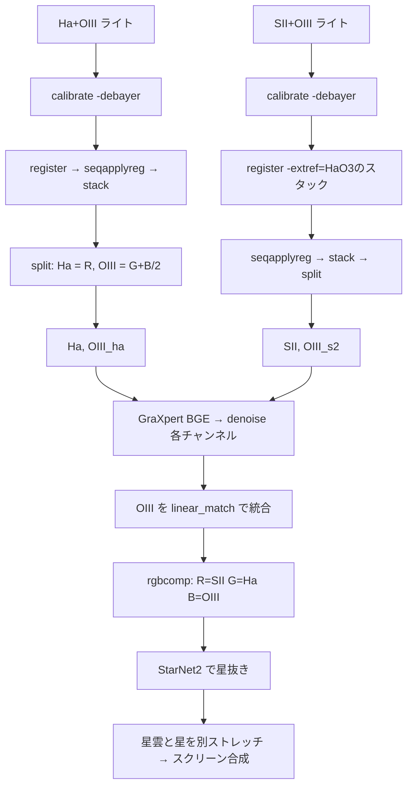

# 02. デュアルナローバンド2枚から SHO

Hα+OIII フィルタと SII+OIII フィルタの2枚（正確には2晩分のライト列）から、
Hα / SII / OIII を分離して SHO 合成します。星は StarNet2 で抜いて別レイヤーにします。



## なぜこの構成か

- **色は物理色ではありません。** SHO は線の強さを色に割り当てた合成なので、
  合成後に SPCC（分光測光キャリブレーション）をかけても意味がありません。
  SPCC は星レイヤーに使う広帯域 RGB に対してかけます。
- **1本のデュアルバンドでは SHO になりません。** 2波長しか通さないので、SII が無ければ
  Ha と OIII の2色しか作れません。「カラフルに」と言われて2色を混ぜたものを SHO と呼ぶのは
  不正確です。3色目が要るなら SII+OIII フィルタで撮る（積算が倍になる）。
- **OIII は2本のフィルタから来る**ので、理論上は積算が2倍になります。弱いのは SII です。
  時間を足すなら SII に振ってください。
- **星は広帯域で撮ったものを使うのが正解**です。ナローバンド由来の星は Ha で膨らみ、
  OIII でドーナツ状のハローになります。f/5.9・4.63µm なら星は1秒で飽和するので、
  20–30秒の広帯域サブでも S/N は十分です。

## ファイル

| ファイル | 役割 |
|---|---|
| `link_lights.sh` | Ekos 名（`NGC_6992_Light_001.fits`）を `light_0001.fits` にリンク |
| `01_stack_hao3.ssf` | Ha+OIII: 較正 → 整列 → スタック → Ha/OIII 分離 |
| `02_stack_s2o3.ssf` | SII+OIII: 同上。`-extref=` で 01 のスタックに位置を合わせる |
| `00_graxpert_channels.sh` | 4チャンネルに BGE → denoise（線形のまま） |
| `03_merge_compose.ssf` | OIII の統合 → SHO 合成（線形） |
| `04_finish_starnet.ssf` | StarNet2 → 星無し/星を別ストレッチ → スクリーン合成 |

## 手順

### 0. ライトの名前を揃える

```bash
scripts/dualband_sho/link_lights.sh /path/work/HaO3
scripts/dualband_sho/link_lights.sh /path/work/S2O3
```

第2引数で glob を指定できます（既定 `*.fits`）。`light_*.fits` は対象から除外されます。

### 1. 較正・整列・スタック・分離

```bash
siril-cli -d /path/work/HaO3 -s scripts/dualband_sho/01_stack_hao3.ssf

# 02 は 01 の出力を外部参照にする。スクリプト内の -extref= を書き換える
siril-cli -d /path/work/S2O3 -s scripts/dualband_sho/02_stack_s2o3.ssf
```

`-extref=` は**絶対パス・拡張子込み**です（`setext` は効きません）。ここを通さないと
2つのスタックが別のピクセル格子に載り、OIII の平均が二重像になります。

フラット・ダークがある夜は `01` / `02` の `calibrate` 行に `-flat=` `-dark=` を足します。
無い夜は `-debayer` だけで通ります（周辺減光とホットピクセルは残ります）。

### 2. チャンネルごとに GraXpert

```bash
mkdir -p /path/ch && cd /path/ch
ln -sf ../HaO3/Ha.fits ../HaO3/OIII_ha.fits ../S2O3/SII.fits ../S2O3/OIII_s2.fits .

GRAXPERT=/opt/graxpert/GraXpert-linux/GraXpert \
  /path/siril-dso-kit/scripts/dualband_sho/00_graxpert_channels.sh .
```

BGE → denoise を各チャンネルに1回ずつ。**OIII は2本の平均で最も弱い**ので、
ここで個別に均しておくと合成後の色が濁りません。CPU だと denoise は 12MP で
1チャンネル約17分（4本で1時間強）かかります。BGE は数分です。

### 3. OIII 統合と SHO 合成

```bash
siril-cli -d /path/ch -s scripts/dualband_sho/03_merge_compose.ssf
```

チャンネルごとに背景レベルが違います（実測例: SII 90 / Ha 102 / OIII 182）。
揃えずに合成すると、背景が最も高いチャンネルへ全体が転びます（この例では SHO が真っ青になった）。
そこで `linear_match ... 0.0 0.01` で背景だけを合わせてから `rgbcomp` します。

露出が違う場合は OIII 統合の `fmul 0.500` ×2 を `t/(t1+t2)` に変えてください。
`fmul` を 0.5 以外にするときも、**合計が 1.0 になるように**（背景を持ち上げないため）。

### 4. 星抜きと仕上げ

```bash
siril-cli -d /path/ch -s scripts/dualband_sho/04_finish_starnet.ssf
```

- 星無しは `SHO_nebula`（`autostretch -linked -2.8 0.15`）
- 星は `SHO_stars`（`-2.8 0.08` と弱め、`satu -1 1` で灰色化）
- 合成は `pm "$nebula$ + $stars$ - $nebula$ * $stars$"`（スクリーン）

星が硬すぎる場合は `pm` の前に `fmul 0.8` を星レイヤーへ。デュアルバンド由来の
星レイヤーは、伸ばしすぎると貼り付けたように見えます。

## 判定ポイント

1. **OIII の平均が二重像になっていないか**（`-extref=` を外すとこうなります）
2. **合成の背景が中性か**（色転びしていれば `linear_match` の窓か順序が違う）
3. **星の色**。ナローバンド星を灰色化し忘れると緑や赤に転びます
4. **淡い部分が BGE に食われていないか**。BGE 前後を並べて、外縁が「増えても減ってもいない」こと

## 正直な限界

- 2つのフィルタで撮った SHO は、3フィルタ（Ha / SII / OIII 別々）の SHO と同じものでは
  ありません。OIII は2倍の積算、Ha と SII は1本ずつという配分になります。
- 星を抜かない構成（`04` を省く）でも `SHO_linear` までは作れます。その場合は
  `autostretch -linked` して `satu 0.3` 程度で仕上げてください。彩度は最後・星雲のみに。
  全画面に彩度を上げると OIII のショットノイズが色斑になります。
