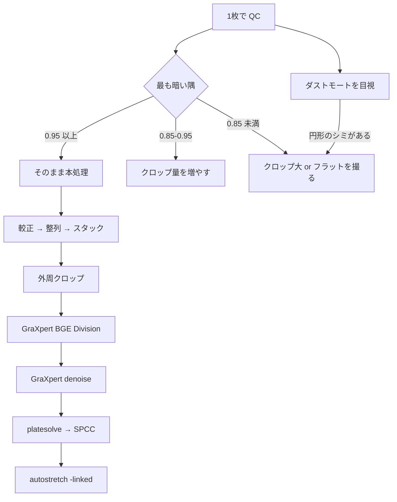

# 03. フラット無しで仕上げる

フラットを撮っていない夜のライト列を、ダーク（またはバイアス）だけで仕上げます。
Siril に合成フラットのコマンドはありません（合成バイアスはあります）。代わりに使えるのが
`subsky -auto` の乗算モードと、GraXpert BGE の除算補正です。

**この方法は「フラットが無い場合の最善」であって、フラットの上位互換ではありません。**
まず撮ってください。無いときだけ、ここに進んでください。



## 1. まず判定する（1分）

```bash
python3 scripts/flatless/qc_flatless.py light_0001.fits --pedestal 500
```

`--pedestal` はカメラのオフセット値（ADU）です。分からなければマスターバイアスを渡します。

```bash
python3 scripts/flatless/qc_flatless.py light_0001.fits --bias master_bias.fits
```

**省略しないでください。** ペデスタルを引かずに測ると減光を過小評価します。

| 最も暗い隅（中心比） | 判定 | 次の行動 |
|---|---|---|
| > 0.95 | 可 | そのまま本処理（`--crop 2` 程度） |
| 0.85 – 0.95 | 条件付き可 | `--crop 5` |
| < 0.85 | 不可寄り | `--crop 8` 以上、またはフラットを撮る |
| 非対称性 > 1.10 | 危険 | ダストか傾き。モデルでは消えない → クロップかフラット |

数値で分からないもの：**ダストモート**。1枚を `autostretch` して、背景の円形の暗いシミを
目視してください。これはどのモデルベースのツール（GraXpert BGE、StarTools Wipe、
APP の人工フラット）でも消せません。小スケール・高コントラスト・センサー固定で、
ディザでは動かないからです。ソフトで消す手段はクロップだけです。

## 2. 本処理

```bash
scripts/flatless/flatless_pipeline.sh \
  --workdir /path/to/lights \
  --lights "light_*.fit" \
  --dark master_dark.fit \
  --sensor "Sony IMX571" \
  --filter "None" \
  --crop 3
```

実行計画だけ確認する場合（安全・ファイルを書きません）：

```bash
scripts/flatless/flatless_pipeline.sh --workdir . --dark master_dark.fit --dry-run
```

### 主なオプション

| オプション | 既定 | 意味 |
|---|---|---|
| `--workdir DIR` | カレント | ライトのあるディレクトリ |
| `--lights GLOB` | `light_*.fit` | ライトのパターン。`light_0001.fit` → シーケンス名 `light` を自動推定 |
| `--seq NAME` | 自動 | シーケンス名を明示 |
| `--dark FILE` | — | マスターダーク（`-cc=dark 3 3` も有効化） |
| `--bias FILE` | — | マスターバイアス |
| `--mono` | off | モノクロカメラ（`-debayer` を付けない） |
| `--crop PCT` | 3 | 各辺を削る割合[%]。0 で無効 |
| `--smoothing V` | 0.35 | GraXpert BGE の smoothing。**0.5 超は外殻を食う** |
| `--denoise V` | 0.5 | GraXpert デノイズ強度。0 でスキップ |
| `--sensor` / `--filter` | — | SPCC 用。`spcc_list oscsensor` で正確な文字列を確認 |
| `--narrowband` | off | SPCC をナローバンド扱い |
| `--skip-spcc` / `--skip-solve` | off | 該当ステップを飛ばす |
| `--out NAME` | `target` | 出力名の接頭辞 |
| `--stage all\|1\|2\|3` | all | 途中から再実行 |
| `--dry-run` | off | `.ssf` を生成して表示するだけ |

## 3. ステージ構成

| ステージ | 実体 | 生成物 |
|---|---|---|
| 1 | Siril: `calibrate` → `register -2pass` → `seqapplyreg` → `stack` | `pp_light*` / `r_pp_light*` / `<out>_stack.fit` |
| 2a | Siril: `crop` | `<out>_crop.fit` |
| 2b | GraXpert BGE（**Division**） | `bge.fits` |
| 2c | GraXpert denoise | `dn.fits` |
| 3 | Siril: `platesolve` → `spcc` → `autostretch` | `<out>_final.tif` / `<out>_final_stretched.fit` |

**この順序である理由**

- 背景除去は**線形**で行う。ストレッチ後では物理的に意味がない
- デノイズも線形で1パス
- クロップは BGE の**前**。外周の極端な減光を残すとモデルが引っ張られる
- `autostretch` は `spcc` の**後**、かつ `-linked`（アンリンクは色バランスを壊す）

減光は**乗算**なので BGE は Division を使います。Subtraction では周辺が持ち上がりません。

## 4. 結果の確認（必須）

1. `bge.fits` を開いて `autostretch` → **対象の形が背景モデルに写っていないか**
2. 補正前後で外縁が「増えても減ってもいない」か
3. 背景が中心から隅まで単調か（リング状の山谷が無いか）

淡い外殻（球状星団の潮汐構造など）を主張する画像では `--smoothing` を 0.3 以下にし、
BGE を2パスにしないでください。

## 5. つまずきやすい点

| 症状 | 原因 / 対処 |
|---|---|
| `スタック結果が見つかりません` | 出力拡張子が `.fits` の可能性。`--out` を変えて再実行 |
| `spcc` で落ちる | センサー/フィルタ名が違う。`spcc_list oscsensor` で確認。オフラインなら `--skip-solve --skip-spcc` |
| `graxpert が見つかりません` | `--graxpert /path/to/graxpert` |
| `FileNotFoundError: out/out/...` | `-output` にディレクトリを渡している。スクリプトは裸名を渡すので通常は起きない |
| 背景がまだリング状 | `--crop` を増やす → `--smoothing` を 0.3 に下げる → それでも駄目ならフラット |
| 色が転ぶ | `autostretch` に `-linked` が付いているか確認（スクリプトは常に付与） |

## 6. 制約

- **ダストモートは消えません。** クロップで外すか、フラットを撮る以外に手段がありません。
- 減光が15%超の光学系では、「捨てる」か「諦めて撮り直す」に収束します。
- M33 のような低表面輝度・画面充填型の対象には向きません。クロップが効かず、BGE が腕を食います。
- 対象が画角に対して小さいこと（周辺を捨てても情報損失が小さいこと）が前提です。
  球状星団のような対象が向いています。

## 別案：Siril だけで閉じる

GraXpert を使わずに済ませたい場合は `subsky -auto -mode=divide` があります。
構造を保護したサンプル不要のロバスト推定で、減光のような乗算の場をモデル化できます。

```
subsky -auto -mode=divide -scale=5 -smoothness=0.5
```

`-scale`（1–10、大きいほど滑らか）、`-protect_threshold=` `-protect_amount=` で
明るい構造をモデルから守れます。GraXpert の AI と違い、サンプル位置を自分で制約できるのが利点です。
